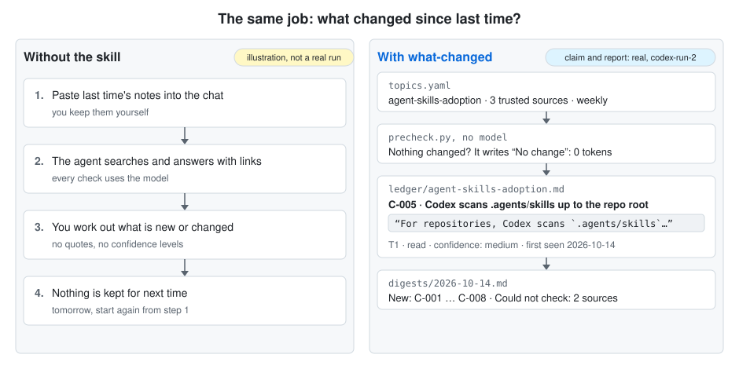

# what-changed

**An agent skill that tells you what changed about the topics you follow since last time, where each fact came from, and how sure it is.**

For anyone who has to stay current on something that changes often, such as a product's releases, an API's prices and limits, a regulation or a market, and wants checkable facts rather than a list of links.

<picture>
  <source media="(prefers-color-scheme: dark)" srcset="docs/images/with-and-without-dark.svg">
  
</picture>

It runs inside the AI coding agent you already use, through the open [Agent Skills](https://agentskills.io) format: tested with Claude Code, OpenAI Codex and Google Antigravity; documented for Cursor, GitHub Copilot, Gemini CLI, OpenCode, Qwen Code and others. Everything is kept in plain text files (Markdown and YAML) in your project. There is no service to sign up for; the skill uses your agent's model and web tools.

## How it works, in one minute

- You name a **topic**, the pages you trust for it (its **sources**) and how often to check it (daily, weekly or monthly).
- When a topic is due, the agent reads its sources and writes what it learned as **claims**: one checkable statement each, with the source, a short quote copied from the page, and a confidence level (`high`, `medium`, `low`, `very-low`) with a reason. The claims of a topic are kept in one file, its **ledger**. When a fact changes, the old claim stays there, marked as replaced.
- Each run ends with a short **digest**, the report you read: what is new, what changed, and what could not be checked. Part of a real one (from [`examples/codex-run-2`](examples/codex-run-2/uptodate/digests/2026-10-14.md)):

  > **New**
  > - **C-005** [agent-skills-adoption] Codex scans `.agents/skills` from the current directory toward the repository root — confidence: medium — [Codex docs](https://developers.openai.com/codex/skills/) (read)
  >
  > **Could not check**
  > - [agent-skills-adoption] https://agentskills.io/this-page-was-removed — inaccessible to the web tool

  `C-005` is the claim's number, `[agent-skills-adoption]` its topic, and `(read)` means the page was opened and quoted.
- Between runs, a small script, `precheck.py`, decides whether the agent is needed at all: it checks which topics are due and whether any source changed. If not, it writes "No change" itself and no model is used, so quiet days are free.

**How you use it:** you talk to the agent in plain messages that start with "Use what-changed:", for example *"Use what-changed: add a topic for …"*, *"… run"* or *"… setup"*. The agent does the research; `precheck.py` (run by you, or by the optional daily timer) only decides whether that research is needed. To change or remove topics, ask the agent or edit `uptodate/topics.yaml`.

All terms and the full method: [docs/how-it-works.md](docs/how-it-works.md).

## Quick start (about 5 minutes)

**You need:** an agent that can search the web and open pages, with a strong current model (tested: Claude Sonnet in Claude Code, and the default models of Codex and Antigravity; a small 9B local model could not follow the skill), and Python 3.11 or later. On macOS, the `python3` from Apple's command line tools can be 3.9 (check with `python3 --version`), which will not work: install a current Python from [python.org](https://www.python.org/downloads/) or with Homebrew (`brew install python`).

**Before you install:** read any third-party skill first, this one included. A skill is instructions plus scripts that run with your agent's permissions.

1. **Install.** Get this repository (clone it, or download it as a ZIP from its GitHub page). Copy the folder `skills/what-changed` (the one that contains `SKILL.md`, the skill's instructions) into your project's skills folder. For Claude Code, run this in your project folder:
   ```bash
   mkdir -p .claude/skills && cp -r /path/to/the/downloaded/repository/skills/what-changed .claude/skills/
   ```
   Other agents use other folders; see [Install](#install). Then start a new agent session in the project, so the agent loads the skill.
2. **Add a topic.** Type this as a normal message to the agent (it is not a slash command):
   *"Use what-changed: add a topic for the Python release schedule and run it."*
   The agent asks what you want to know, which sources you trust and how often to check, creates the folder `uptodate/` in your project folder, and does the first run. A first run reads several pages and checks each claim, so it costs far more than later runs: in tests, one topic used roughly 125k–150k tokens in Codex, and about 0.6M input tokens in Claude Code with Sonnet, most of them cache reads ([cost figures](docs/results.md#cost)).
3. **Read** the report: `uptodate/digests/<today's date>.md`.
4. **Next time**, start with the free check. It uses no model, works out by itself which topics are due (so running it every day is safe), and adds to today's report, creating it if needed:
   ```bash
   python3 .claude/skills/what-changed/scripts/precheck.py --store uptodate
   ```

   | Exit code | Meaning | What to do |
   |---|---|---|
   | 0 | No topic had reached its next check date, or none of the due topics' sources changed. It added a "No change" section to today's report, listing any topic whose sources could not be reached. | Nothing |
   | 2 | It could not read `topics.yaml` (not in the simple format it reads) or refused to write a file. | Tell the agent: *"Use what-changed: run"* |
   | 10 | A source changed, or a claim is due for a re-check. | Tell the agent: *"Use what-changed: run"* |
   | 11 | No topic that was due could be checked, because none of its sources could be reached. | Read the reason it prints (often a sandbox or proxy blocking the sites) and try again later |
   | any other (not 0, 2, 10 or 11) | precheck itself failed. This is an error, not a quiet day. | Read its output; to check the topics anyway, tell the agent *"Use what-changed: run"* |

   Each page fetch stops after three times `--timeout` (60 seconds by default), and a page that needs longer is listed as could not check; on a very slow link, raise `--timeout`.

5. **Every day, automatically** (optional): tell the agent *"Use what-changed: setup"*. It offers a timer that runs the check every morning, a reminder when you open a session, or both; shows every file it would write; and changes nothing until you say yes. The timer's first run approves your `topics.yaml` as it is then and prints the hosts it will fetch from; after that, a run stops while `topics.yaml` has changes you have not approved, and its message gives the command that approves them. Updating from a version before 0.1.6 with the timer already set up: its first run after the update stops once for this approval. Details: [adapters/README.md](skills/what-changed/adapters/README.md).

## What you get

```
uptodate/
├── topics.yaml              what you follow, from which sources, how often
├── ledger/<topic>.md        one block per claim: sources, quote, confidence, status, history
├── digests/2026-10-14.md    the report you read: new · changed · disputed · could not check
└── runs.log                 one line per run
```

A digest entry (from [`examples/codex-run-2`](examples/codex-run-2/uptodate/digests/2026-10-14.md)):

> **C-005** [agent-skills-adoption] Codex scans `.agents/skills` from the current directory toward the repository root — confidence: medium — [Codex docs](https://developers.openai.com/codex/skills/) (read)

The same claim in the ledger, with what backs it:

```markdown
### C-005 · Codex scans .agents/skills in the current directory and parent directories up to the repository root
- status: active
- confidence: medium — official Codex documentation, read; counter-evidence not searched (budget)
- sources:
  - [Codex skills](https://developers.openai.com/codex/skills/) — T1 — read — quote: "For repositories, Codex scans `.agents/skills` in every directory from your current working directory up to the repository root."
- first_seen: 2026-10-14 · last_confirmed: 2026-10-14 · review_by: 2027-01-14
```

How to read it: `T1` means an official or primary source (T2–T4 are weaker kinds); `read` means the page was opened and the quote copied from it; "not searched (budget)" means the run used up its page and search limit before looking for evidence against the claim, which caps confidence at `medium`. The ledger keeps one such block per claim; the digest is the short daily report built from them. Scripts in the skill check these files without a model: every quote can be looked up again on its page, and no confidence level may be higher than its sources allow ([checks you can run](docs/how-it-works.md#checks-you-can-run-without-trusting-the-model)).

## Install

Copy `skills/what-changed/` into your agent's skills folder. Most people want the project folder; `uptodate/` is then created in the folder where you run the agent:

| Agent | Folder |
|---|---|
| Claude Code | `.claude/skills/what-changed/` (this project) or `~/.claude/skills/what-changed/` (all projects) |
| Codex, Gemini CLI, Antigravity, Cursor, GitHub Copilot, OpenCode, Kimi Code | `.agents/skills/what-changed/` or `~/.agents/skills/what-changed/` |
| Qwen Code | `.qwen/skills/what-changed/` |
| Claude.ai | zip the folder, then Customize → Skills → Upload (code execution must be on) |

**As a Claude Code plugin.** This repository is also a plugin marketplace. In a Claude Code session (version 2.1.275 or later):

```text
/plugin install what-changed --marketplace tonnpeera/what-changed
```

Or from your shell:

```bash
claude plugin marketplace add tonnpeera/what-changed
claude plugin install what-changed@what-changed
```

The skill is then `what-changed:what-changed`. Updates: `claude plugin update what-changed@what-changed`. To try it for one session without installing, clone the repository and start Claude Code with `claude --plugin-dir /path/to/what-changed`. To run `precheck.py` yourself, use the copy in a clone (`skills/what-changed/scripts/`).

## Operating systems

| OS | Status |
|---|---|
| macOS | Tested: the test suite (Python 3.11 and 3.14, locally), real runs, and the daily timer script (`run-daily.sh`) with a real `claude -p` |
| Linux | Not tested yet. The scripts use only the Python standard library, and the daily timer script is plain bash |
| Windows | Not tested yet. The scripts avoid POSIX-only calls (the fallbacks are covered by the test suite); the daily timer script for Task Scheduler, `run-daily.ps1`, has not been run |

On Windows, use `py -3` (or `python`) where this README says `python3`.

## Limits

- **Only as good as the agent's web tools.** Built-in search can be tied to one country and weak on non-English sites; page-reading tools may summarise instead of quoting. The quote check catches the second problem afterwards; it cannot fix the first.
- **No PDF quotes.** A change in a PDF is detected, but quotes in PDFs cannot be checked, so claims from PDFs need a human check.
- **No social media** (Reddit, X, YouTube) unless your agent has tools for them.
- **A first run is not cheap**, because every new claim is traced and checked. Quiet days cost nothing with `precheck`.
- **Model-dependent.** Different models rate confidence differently; that is why the check scripts exist.
- **Tested on macOS only** so far. Host details in the adapter table were checked on 2026-10-14 and will drift.

## Results

The skill was tested three times against a plain agent with the same model and tools, with pass criteria written down before each run. It was not shown to be better. Quality was about the same: accuracy 1.94 against 1.87 (0–2) in [round 1](docs/benchmark.md) and 1.91 against 2.00 in [round 2](docs/benchmark.md#round-2-the-cheaper-skill-against-a-plain-agent-2026-10-16); in [round 3](docs/benchmark.md#round-3-watching-the-same-topics-over-several-runs-2026-10-16), which watched four pages over six weekly rounds, both caught all 5 changes, and the skill raised no false alarms against the plain agent's 2 in 31 unchanged checks (not significant). It cost more every time: 5.7, 2.8 and 3.1 times the input tokens. The free pre-check ended only one of five watching rounds without a model. What the project offers is the method: a claim ledger whose quotes scripts can re-check, and a benchmark whose rules were fixed before the runs.

Round 1 in a chart (27 items with known answers):

<picture>
  <source media="(prefers-color-scheme: dark)" srcset="docs/images/benchmark-dark.svg">
  
</picture>

Setup, all measures and caveats of the three rounds: [docs/benchmark.md](docs/benchmark.md). Token use and example runs: [docs/results.md](docs/results.md).

## More

- [How it works](docs/how-it-works.md): terms, what a run does, the checks you can run, practical notes
- [Cost and results](docs/results.md): token use, example runs, and a [benchmark against a plain agent](docs/benchmark.md)
- [Security](docs/security.md): what an unattended run may and may not do
- [Daily runs on each agent and OS](skills/what-changed/adapters/README.md)
- [Example stores](examples/README.md)

## License

MIT. See [LICENSE](LICENSE).
