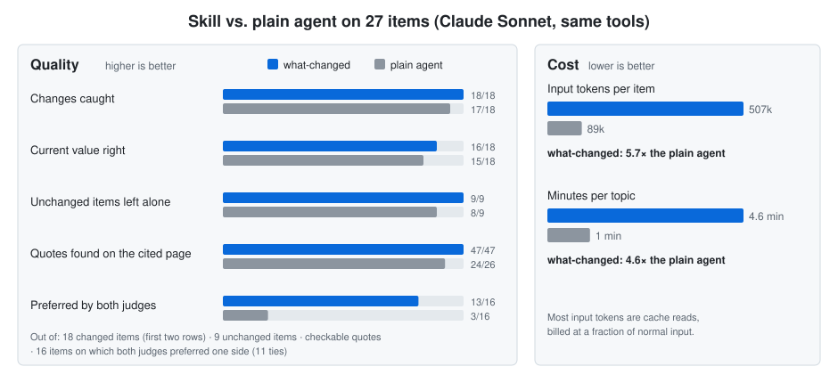

# Cost and results

## Cost

Token numbers from different hosts are **not comparable**: each host counts differently, and caching changes what a token costs. What was measured in test runs (rows 1–2: Claude Code with a two-topic test store that is not in `examples/`):

| Run | Host | What the host reported | Input processed over the whole run | Pages read | Searches |
|---|---|---|---|---|---|
| First run, 2 topics (one `light` with 7 claims to re-check, one `full`) | Claude Code sub-agent, Sonnet model | 153,051 (size of the last request's context) | 3,192,382 over 29 model calls, of which 3,041,463 cache reads | 13 | 7 |
| Nothing changed, handled by the agent | same | 83,144 (same meaning) | 369,166 over 5 calls, of which 319,505 cache reads | 0 | 0 |
| First run, 1 topic (`full`) | OpenAI Codex CLI | 150,532 "tokens used" | not available; the counting method is not documented | 9 | 10 |
| First run, 1 topic (`full`), a second separate run | OpenAI Codex CLI (bundled with the ChatGPT desktop app) | 125,572 "tokens used" (same) | not available | 8 | 8 |
| First run, 1 topic (`full`) | Google Antigravity desktop app | nothing reported | not available | 7 | 7 |
| Nothing changed, handled by `precheck` (agent never started) | none: plain script, 1–4 seconds | **0** model tokens | 0 | 0 | 0 |

How to read it: the Claude Code "input processed" column was added up from the sub-agents' transcripts (every model call re-sends the conversation so far; most of it is served from cache, which is billed at a fraction of normal input). Output tokens are not reliably recorded in those transcripts, so they are left out. The skill's own instructions and files are about 10k tokens; the rest is the host's system prompt, tool definitions and the growing conversation. The practical takeaway does not depend on the counting method: a first run is expensive, a quiet day handled by an agent still costs something, and a quiet day handled by `precheck` costs nothing.

## Example runs

Real runs on 2026-10-14, kept in [`examples/`](../examples/README.md): two in OpenAI Codex and one in the Google Antigravity desktop app, each with the same topic (which agent tools support the Agent Skills format). Numbers are passed / total, checked with the current checker (the run-time rule compares times with file dates, so a copy of the files can count one or two checks more or fewer).

| What was tested | Result |
|---|---|
| Codex run (6 claims): rule checks / quotes found on the cited page | 109 of 109 · 12 of 12, checked afterwards (inside Codex's sandbox the pages were unreachable; the run reported that instead of guessing) |
| Second, separate Codex run (8 claims): rule checks / quotes found | 115 of 115 · 10 of 10, also checked afterwards |
| Google Antigravity desktop app (8 claims): rule checks / quotes found | 112 of 112 · 9 of 9 · took at most about 8–9 minutes (estimated from file times, not measured) |
| A deliberately dead source reported under "Could not check" | 3 of 3 runs |
| A small local model (Codex + Ollama, `qwen3.5:9b`) | **failed**: never loaded the skill, wrote nothing |

## Other tests (stores not published)

| What was tested | Result |
|---|---|
| Claude Code, 2 topics; 7 claims written in advance and labelled `unverified`, to be re-read on a primary source | 7 of 7 re-read (one was wrong and is superseded by a corrected claim) · new release in the official changelog recorded: 1 of 1 · rule checks 298 of 298 · quotes 28 of 28 |
| A fresh `claude -p` session with the skill installed at project level, two topics (an English technical changelog, an official site in Thai) | First digest for both topics in about 6 minutes · quotes found 12 of 12 · rule checks all passed · the next day through `precheck`: 0 tokens, about 1 second |

Hosts: **run** Claude Code, OpenAI Codex, Google Antigravity (desktop app) · **documented, not yet run** the others. Details per host: [host table](../skills/what-changed/adapters/README.md).

## Benchmark against a plain agent

<picture>
  <source media="(prefers-color-scheme: dark)" srcset="images/benchmark-dark.svg">
  
</picture>

Given old notes on 27 items in 6 topics (AI model deprecation dates, language and platform release status, central-bank rates, a minimum wage, certificate rules), does the skill find what changed better than an agent that just searches the web? Both sides were Claude Sonnet sub-agents with only web search and page fetching; two judges compared the answers blind.

| Measure | Skill | Plain agent |
|---|---|---|
| Changes caught | 18 of 18 | 17 of 18 |
| Changes caught with the current value right | 16 of 18 | 15 of 18 |
| Unchanged items correctly left alone | 9 of 9 | 8 of 9 |
| Quotes in the answers found on the cited page | 47 of 47 checkable | 24 of 26 |
| Blind preference (both judges agree) | 13 wins | 3 wins (11 ties; sign test p = 0.021) |
| Input tokens processed per item | about 507k | about 89k |

The accuracy gap is small; the clearer gap is in citations, and part of it probably comes from the list of official sources the skill was given. The skill costs about 5.7 times the input tokens and 4.6 times the time. Setup, criteria, all measures and caveats: [benchmark.md](benchmark.md).
